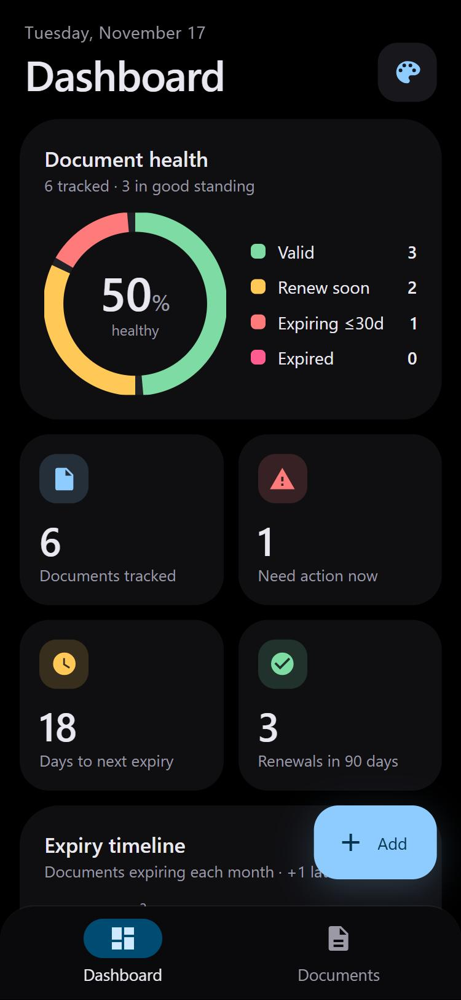
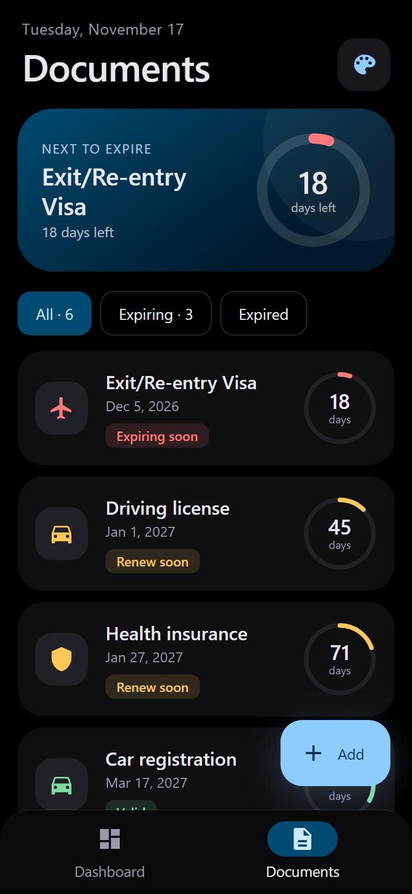
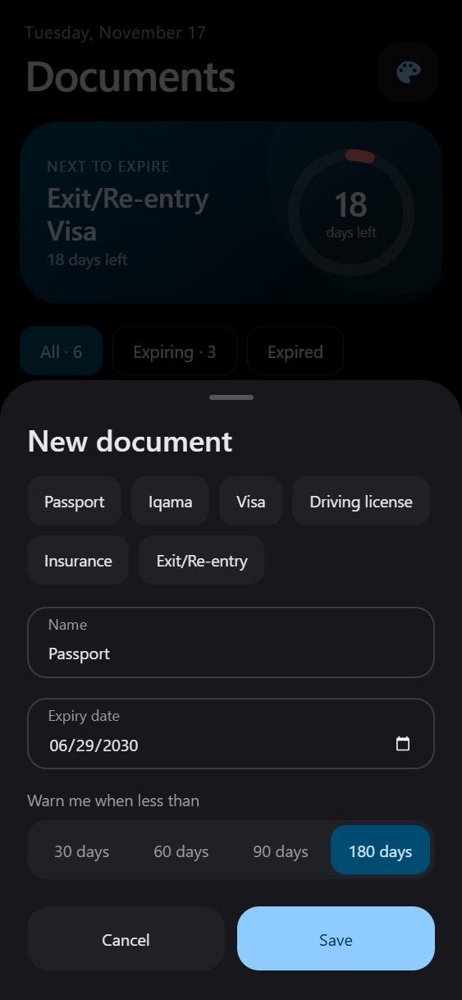
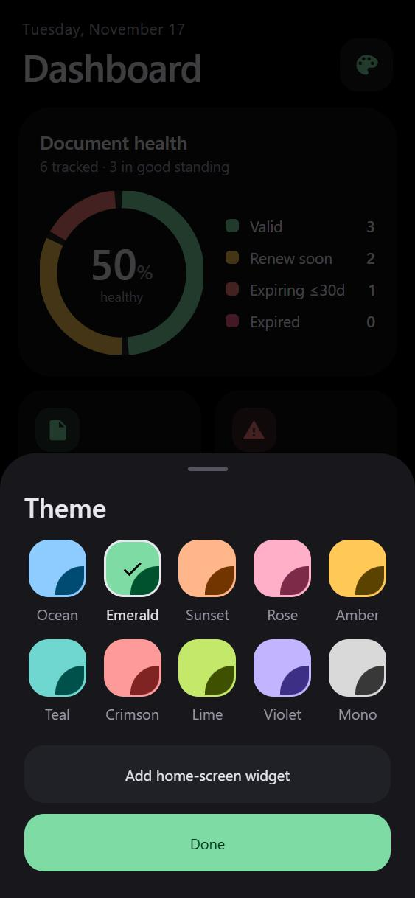

<div align="center">


# Countly

**Never miss a renewal again.** A beautiful countdown tracker for your visa, iqama, passport, licence and every other document that expires.

[](https://github.com/nome2050/countly/actions/workflows/build.yml)


[**Download the latest APK**](https://github.com/nome2050/countly/releases/latest)

</div>

---

## Screenshots

<table>
  <tr>
    <td align="center"><br><sub><b>Dashboard</b><br>health score and key numbers</sub></td>
    <td align="center"><br><sub><b>Analytics</b><br>12-month timeline, up next, insights</sub></td>
    <td align="center"><br><sub><b>Documents</b><br>live countdown for each one</sub></td>
  </tr>
  <tr>
    <td align="center"><br><sub><b>Add or edit</b><br>quick presets, custom warning window</sub></td>
    <td align="center"><br><sub><b>10 themes</b><br>plus the home-screen widget button</sub></td>
    <td></td>
  </tr>
</table>

<sub>Screenshots are taken from the app's interface at phone size with sample data.</sub>

## Features

- **Countdown for every document:** days left, plus an exact "2 years, 3 months, 5 days" breakdown, with a progress ring.
- **Colour-coded status:** green when valid, amber when it is time to renew, red when it expires within 30 days or has expired.
- **Dashboard:** a document-health donut chart, key counters, a 12-month expiry timeline, your closest deadlines, and insights such as average time left.
- **Home-screen widgets in 4 sizes, built to read at a glance:** *Next* (2×2 ring with the days left), *Glance* (4×2: your most urgent document big, the next three beside it), *List* (4×3 deadlines with colour chips) and *Dashboard* (4×4 status counters plus deadlines). They follow your theme and refresh daily.
- **Reminders and alerts:** a daily notification that lists everything pending and how long is left. Choose reminders 1 month, 2 weeks, 1 week, 2 days, 1 day before and on the day, plus weekly or daily nagging for overdue items and an optional daily summary. Items due within 2 days, today or overdue arrive as urgent alerts. The Dashboard also shows what needs attention.
- **Calendar import:** pull renewals in from Google Calendar or Outlook, either by reading the calendars on your phone (any account that syncs to it) or from an ICS link or file.
- **AI assistant (optional, bring your own Groq key):** *Smart add* turns pasted text into documents, *Ask Countly* answers questions about your documents, plus renewal tips and AI selection of renewal-like calendar events.
- **19 categories with icons** (passport, visa, ID, licence, vehicle, insurance, health, study, work, home, card, plans, warranty, pet, gov, phone, member, utility, other).
- **Overdue in days, months or years** (or Auto) in Settings.
- **Backup / restore** of your documents, including pasting one document per line.
- **Private by default:** everything is stored on your phone. No account, no server, no tracking. The only network use is what you switch on yourself (see Privacy).
- **Made for real life:** quick presets (Passport, Iqama, Visa, Driving licence, Insurance, Exit/Re-entry), Arabic names supported, undo after delete, and the Back button closes sheets before leaving the app.

## Install on your phone

1. Open the [latest release](https://github.com/nome2050/countly/releases/latest) on your phone and download **Countly.apk**.
2. Tap the file. When Android asks, allow **Install unknown apps** for your browser or file manager.
3. If Play Protect warns about an unknown app, choose **Install anyway**. This is normal for apps installed outside the Play Store.

Designed for Android 13 and newer.

### Add the widgets
Four sizes: **Next** (2×2), **Health** (4×2), **List** (4×3) and **Dashboard** (4×4). Open Countly, tap the palette button in the top right, then **Add home-screen widget** (adds the List widget).
You can also long-press the home screen, open **Widgets**, and drag the widget you want out. Make it taller to show more documents.

## Build it yourself (no Android Studio needed)

The APK is built in the cloud with GitHub Actions:

1. Fork or push this repo to your own GitHub account.
2. Open **Actions**, then **Build APK**. A run starts on every push to `main` (or click **Run workflow**).
3. When it finishes, the APK is published on the repo's **Releases** page as `Countly.apk`.
   It is also attached to the run as an artifact (GitHub always zips artifacts, so the Releases page is the easier download).

## How it works

| Part | What it does |
| --- | --- |
| `www/` | The app itself: plain HTML, CSS and JavaScript with no frameworks. |
| [Capacitor](https://capacitorjs.com) | Wraps `www/` into a real Android app. |
| `native/` | The Java code: the four home-screen widgets (`WidgetRenderer` draws them as images), the daily reminder (`Notifier`, `NotifyReceiver`, `BootReceiver`) and the bridge (`WidgetBridgePlugin`) that carries your data, notification and phone-calendar access. |
| `scripts/add-widget.js` | Adds the four widget sizes to the generated Android project during the build. |
| `scripts/add-branding.js` | Adds the app icon (including the Android 13+ themed icon), the black splash screen and the black system bars. |
| `scripts/add-signing.js` | Signs every build with the same key and gives it a rising version number, so it installs as an update and keeps your data. |
| `signing/countly.keystore` | The fixed signing key (personal-use debug key, not for the Play Store). |
| `.github/workflows/build.yml` | Builds the debug APK and publishes it. |

### Run it in a browser
```bash
cd www
python -m http.server 8000
```
Then open http://localhost:8000. The widget only works in the installed Android app.

## Project status

Countly is a debug build intended for personal use. The interface and date logic are covered by browser tests (about 90 checks across phone sizes, tablet and landscape). The widget drawing code is new and has only been compile-checked, so please report anything that looks off. The widget and Android integration were built to the standard Android APIs for versions 13 to 17; please open an issue if something looks wrong on your phone and include your phone model and Android version.

## Updating without losing data

Every build is signed with the same key (`signing/countly.keystore`) and has a higher version number than the last one, and the app ID never changes. Android therefore installs a new APK **over** the old one and keeps all your documents and settings. Documents from older versions load unchanged.

> If Android ever says *App not installed*, the installed copy was signed with a different key (this can happen once, when moving from builds made before fixed signing). Use **Settings > Copy backup** in the app first if you can, then uninstall and install the new APK once; after that every update installs in place.

### Keeping the signing key in GitHub Secrets (recommended)

In the repo go to **Settings > Secrets and variables > Actions > New repository secret** and add:

| Secret | Value |
| --- | --- |
| `COUNTLY_KEYSTORE_BASE64` | the keystore file as base64 (`base64 -w0 signing/countly.keystore`) |
| `COUNTLY_KEYSTORE_PASSWORD` | the keystore password |
| `COUNTLY_KEY_ALIAS` | `countly` |
| `COUNTLY_KEY_PASSWORD` | the key password |

The build log then says *Signing with the key from GitHub Secrets*. It must be the **same key** as before, otherwise updates stop installing over the old app. Keep a private backup of the keystore: if it is lost, nobody can update the app any more.

## Privacy

Your documents are stored only on your phone. Countly has no analytics, no account and no server of its own.

Three optional things use the network, and only when you use them:
- **AI features:** when you paste a Groq API key in Settings and use Smart add, the assistant, renewal tips or the calendar AI picker, the relevant document names and dates (or the calendar event titles) are sent to Groq to get an answer. Your key is stored only on your phone. Remove the key to turn AI off.
- **ICS link import:** fetches the calendar link you paste.
- **Phone calendar import:** reads your phone's calendars on the device and sends nothing anywhere. It needs the calendar permission.

Notifications use the notification permission and run entirely on the phone.
